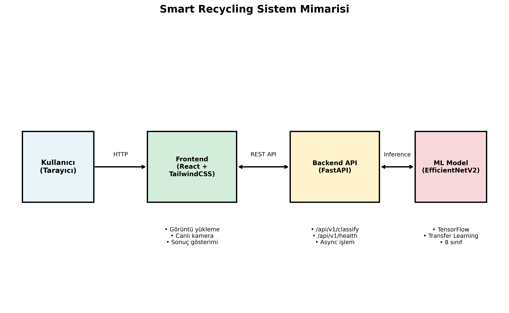
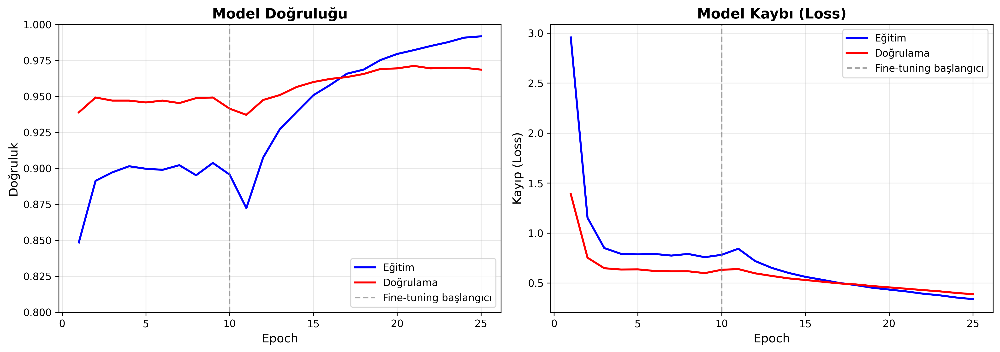
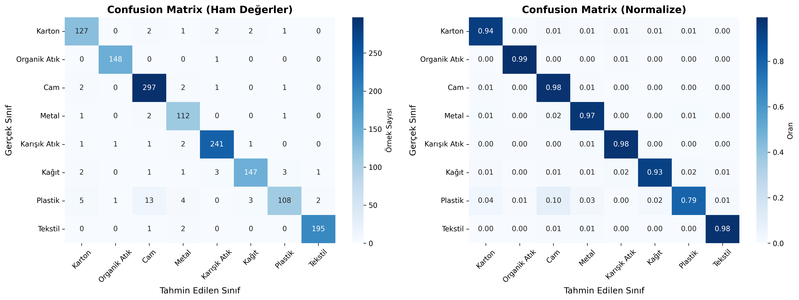
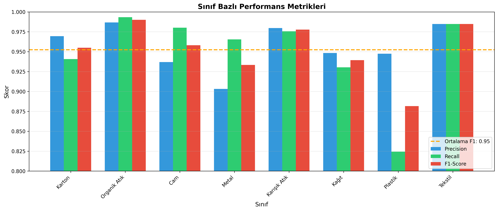

# SmartRecycling - AI-Powered Waste Classification System

A deep learning-based waste classification and recycling guidance system developed for the BM5113 Computer Vision course.

Achieved **97.3% test accuracy** using **EfficientNetV2-S** transfer learning.



---

## Features

- Image-based waste type classification (8 classes)
- Recycling instructions and environmental impact information
- Drag-and-drop image upload
- Real-time classification via live camera
- REST API integration (FastAPI)
- One-command deployment with Docker

## Classes

| Class | Bin Color | Recyclable |
|-------|-----------|------------|
| Cardboard | Blue | Yes |
| Food Organics | Brown | Compost |
| Glass | Green | Yes |
| Metal | Yellow | Yes |
| Miscellaneous Trash | Gray | No |
| Paper | Blue | Yes |
| Plastic | Yellow | Yes |
| Textile Trash | Purple | Reusable |

---

## Tech Stack

### Backend & ML
- Python 3.11, TensorFlow 2.15, FastAPI, Scikit-learn
- EfficientNetV2-S (ImageNet pretrained)
- Albumentations (data augmentation)

### Frontend
- React 18, Vite 5, Tailwind CSS 3, Axios

### DevOps
- Docker, Docker Compose, Nginx

---

## Project Structure

```
SmartRecycling/
├── api/                        # FastAPI backend
│   ├── main.py                 # API entry point
│   ├── routes/
│   │   ├── classification.py   # /classify, /categories, /model/info
│   │   └── health.py           # /health
│   └── schemas/
│       └── prediction.py       # Pydantic models
├── src/                        # ML modules
│   ├── data/
│   │   ├── preprocessing.py    # Image preprocessing
│   │   ├── augmentation.py     # Data augmentation
│   │   └── dataloader.py       # Dataset loading
│   ├── training/
│   │   ├── trainer.py          # 2-phase training
│   │   ├── callbacks.py        # Keras callbacks
│   │   └── metrics.py          # Evaluation metrics
│   ├── inference/
│   │   └── predictor.py        # Production inference class
│   └── utils/
│       ├── logger.py           # Logging
│       └── visualization.py    # Visualization
├── frontend/                   # React SPA
│   └── src/
│       ├── App.jsx
│       ├── components/
│       │   ├── ImageUploader.jsx
│       │   ├── ClassificationResult.jsx
│       │   ├── RealtimeCamera.jsx
│       │   └── RecyclingGuide.jsx
│       └── services/
│           └── api.js
├── configs/
│   └── config.yaml             # Central configuration
├── docker/
│   ├── Dockerfile.api
│   ├── Dockerfile.frontend
│   └── nginx.conf
├── notebooks/
│   └── model_training.ipynb    # Google Colab training notebook
├── saved_models/               # Trained models
├── scripts/                    # Utility scripts
├── docker-compose.yml
└── requirements.txt
```

---

## Installation & Usage

### With Docker (Recommended)

```bash
docker-compose up --build
```

- Frontend: http://localhost:3000
- API: http://localhost:8000
- API Docs: http://localhost:8000/docs

### Manual Setup

**Backend:**
```bash
python -m venv venv
source venv/bin/activate
pip install -r requirements.txt
uvicorn api.main:app --reload --port 8000
```

**Frontend:**
```bash
cd frontend
npm install
npm run dev -- --port 3000
```

The frontend automatically proxies API requests to `localhost:8000`.

---

## API Endpoints

| Method | Endpoint | Description |
|--------|----------|-------------|
| `GET` | `/api/v1/health` | System health check |
| `POST` | `/api/v1/classify` | Image classification |
| `GET` | `/api/v1/categories` | All categories |
| `GET` | `/api/v1/model/info` | Model information |

### Classification Example

```bash
curl -X POST http://localhost:8000/api/v1/classify \
  -F "file=@test_image.jpg"
```

```json
{
  "predicted_class": "plastic",
  "confidence": 0.95,
  "recycling_info": {
    "bin_color": "yellow",
    "recyclable": true,
    "instructions": "Rinse and place in the yellow bin",
    "environmental_impact": "Plastic stays in nature for 450 years"
  },
  "top_k_predictions": [...],
  "processing_time_ms": 145.23
}
```

---

## Model Architecture

```
Input (224x224x3)
       |
EfficientNetV2-S (ImageNet pretrained, 21.4M params)
       |
Global Average Pooling
       |
Dropout (0.4)
       |
Dense (256, ReLU, L2)
       |
BatchNormalization
       |
Dropout (0.3)
       |
Dense (8, Softmax)
       |
Output
```

### 2-Phase Training Strategy

**Phase 1 - Feature Extraction:**
- Base model layers frozen
- Only dense layers are trained
- LR: 0.001 | Epochs: 15

**Phase 2 - Fine-Tuning:**
- Last 30% of base model layers unfrozen
- Entire network trained with lower learning rate
- LR: 0.00001 | Epochs: 20



---

## Model Performance

**Test Set Results (2,335 samples):**

| Metric | Value |
|--------|-------|
| Overall Accuracy | 97.30% |
| Macro F1-Score | 95.38% |
| Weighted F1-Score | 97.27% |

### Per-Class Performance

| Class | Precision | Recall | F1-Score |
|-------|-----------|--------|----------|
| Cardboard | 96.95% | 94.07% | 95.49% |
| Food Organics | 98.67% | 99.33% | 99.00% |
| Glass | 93.69% | 98.02% | 95.81% |
| Metal | 90.32% | 96.55% | 93.33% |
| Misc. Trash | 97.97% | 97.57% | 97.77% |
| Paper | 94.84% | 93.04% | 93.93% |
| Plastic | 94.74% | 82.44% | 88.16% |
| Textile Trash | 99.45% | 99.64% | 99.54% |




---

## Dataset

~22,000+ images merged from 3 different sources:

| Source | Image Count |
|--------|-------------|
| RealWaste | ~4,752 |
| Garbage Classification | ~15,150 |
| TrashNet | ~2,527 |

**Split:** 70% Train / 15% Validation / 15% Test

**Augmentation:** Rotation (+-40), ShiftScaleRotate, HorizontalFlip, RandomBrightnessContrast, GaussNoise, GaussianBlur

---

## System Architecture

```
User (Browser)
        |
   React Frontend (Port 3000)
   - Image upload / Live camera
   - Result display
   - Recycling guide
        |
   Nginx Reverse Proxy
   - Static file serving
   - /api → Backend proxy
        |
   FastAPI Backend (Port 8000)
   - /classify, /health, /categories
   - CORS, async processing
        |
   WastePredictor
   - Preprocessing → Inference → Postprocessing
        |
   EfficientNetV2-S Model
   - 8-class prediction + confidence scores
```

---

## License

This project was developed as part of the BM5113 Computer Vision course.
