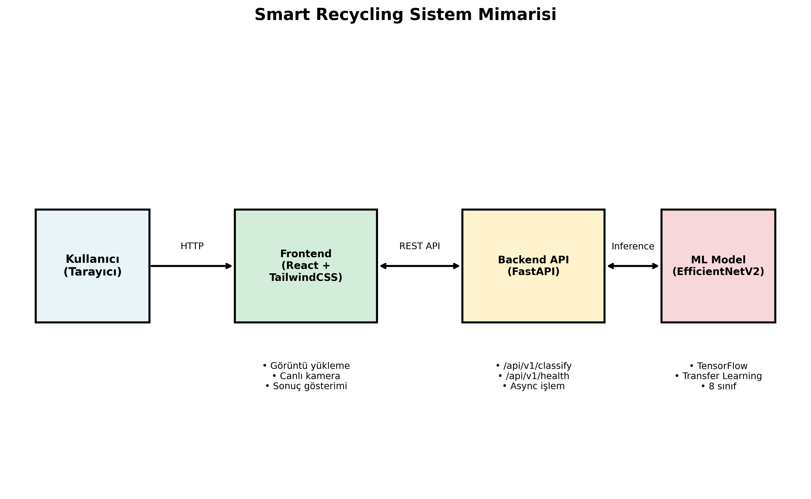
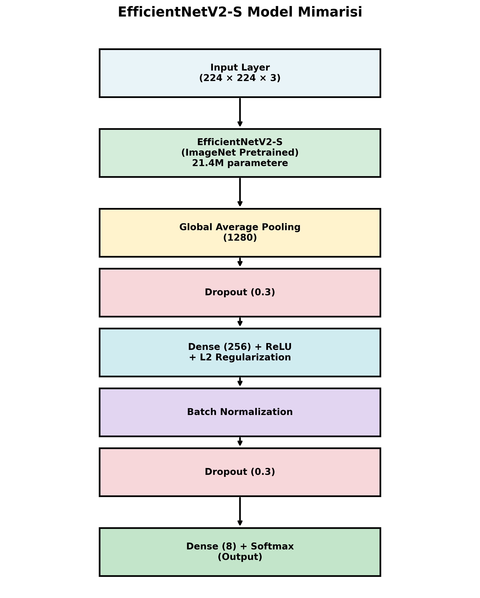
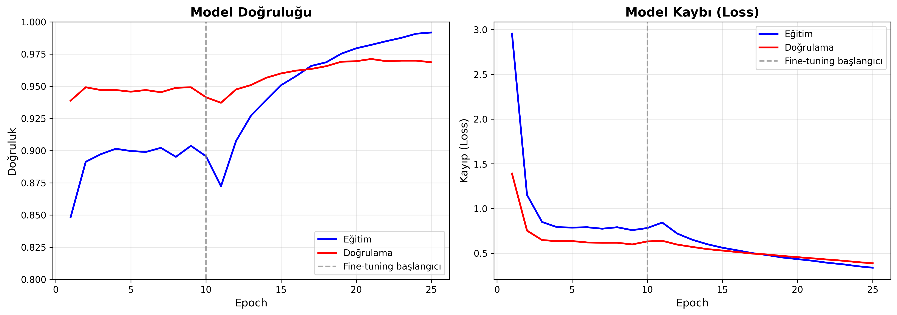
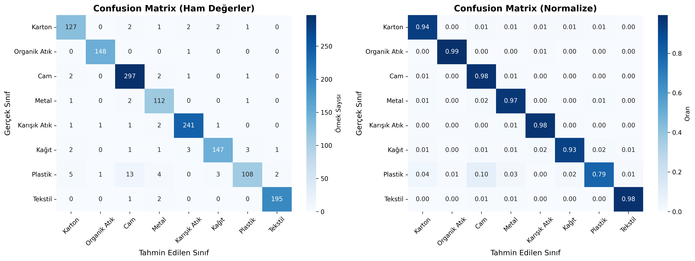
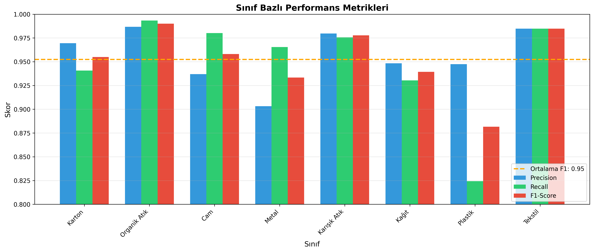

# Smart Recycling: Derin Öğrenme ile Akıllı Atık Sınıflandırma Sistemi

**Halim Malcok**

Bilgisayar Mühendisliği Bölümü, Bursa Uludağ Üniversitesi, Bursa

e-posta: halimmalcok@ogr.uludag.edu.tr

---

## Özet

Bu çalışmada, derin öğrenme ve transfer learning teknikleri kullanılarak otomatik atık sınıflandırma sistemi geliştirilmiştir. EfficientNetV2-S mimarisi temel alınarak oluşturulan model, 8 farklı atık kategorisini (karton, organik atık, cam, metal, karışık atık, kağıt, plastik, tekstil) yüksek doğrulukla sınıflandırabilmektedir. Çoklu veri seti birleştirme stratejisi (RealWaste, Garbage Classification, TrashNet) ile toplam ~22.000 görüntü üzerinde gerçekleştirilen deneylerde, iki aşamalı eğitim stratejisi (feature extraction ve fine-tuning) ile **%97.30 test doğruluğu** elde edilmiştir. Geliştirilen sistem, FastAPI tabanlı REST API ve React web arayüzü ile kullanıcı dostu bir şekilde sunulmakta olup gerçek zamanlı kamera sınıflandırma özelliği de içermektedir. Sonuçlar, transfer learning ve veri çeşitlendirme yaklaşımının atık sınıflandırma probleminde son derece etkili bir çözüm sunduğunu göstermektedir.

**Anahtar Kelimeler:** Atık sınıflandırma, transfer learning, EfficientNetV2, derin öğrenme, bilgisayarla görme, gerçek zamanlı sınıflandırma, çoklu veri seti

---

## 1. Giriş

Günümüzde artan nüfus ve tüketim alışkanlıkları, atık yönetimini küresel bir sorun haline getirmiştir. Dünya genelinde yılda yaklaşık 2 milyar ton katı atık üretilmekte olup bu miktarın 2050 yılına kadar %70 artması beklenmektedir [1]. Etkili atık yönetimi ve geri dönüşüm, çevresel sürdürülebilirlik için kritik öneme sahiptir.

Geleneksel atık sınıflandırma yöntemleri, manuel işlem gerektirmekte ve yüksek maliyetli olmaktadır. Otomatik sınıflandırma sistemleri bu problemi çözmeye yönelik önemli bir potansiyel sunmaktadır. Son yıllarda derin öğrenme ve bilgisayarla görme alanındaki gelişmeler, görüntü tabanlı otomatik sınıflandırma sistemlerinin geliştirilmesini mümkün kılmıştır.

Bu çalışmanın temel katkıları şunlardır:
- EfficientNetV2-S mimarisine dayalı **%97.30 test doğruluğu** ile atık sınıflandırma modeli
- Çoklu veri seti birleştirme stratejisi ile ~22.000 görüntülük genişletilmiş eğitim verisi
- İki aşamalı transfer learning eğitim stratejisi (feature extraction + fine-tuning)
- Kullanıcı dostu React web arayüzü ile entegre FastAPI REST API
- WebRTC tabanlı gerçek zamanlı kamera sınıflandırma özelliği
- 8 farklı atık kategorisinin otomatik sınıflandırılması ve geri dönüşüm rehberi

Raporun geri kalanı şu şekilde organize edilmiştir: Bölüm 2'de ilgili çalışmalar incelenmiş, Bölüm 3'te önerilen yöntem detaylandırılmış, Bölüm 4'te deneysel sonuçlar sunulmuş, Bölüm 5'te tartışma yapılmış ve Bölüm 6'da sonuçlar özetlenmiştir.

---

## 2. İlgili Çalışmalar

### 2.1. Atık Sınıflandırma Sistemleri

Otomatik atık sınıflandırma alanında çeşitli çalışmalar gerçekleştirilmiştir. TrashNet [2] projesi, Stanford Üniversitesi'nde 6 kategorili atık veri seti oluşturarak bu alanda öncü çalışmalardan biri olmuştur. Çalışmada SVM ve basit CNN mimarileri kullanılarak %90+ doğruluk elde edilmiştir.

Aral ve ark. [3] çalışmasında, VGG-16 ve ResNet modelleri karşılaştırılmış ve transfer learning yaklaşımının küçük veri setlerinde etkili olduğu gösterilmiştir. Benzer şekilde, Yang ve Thung [4] çalışmasında farklı CNN mimarilerinin atık sınıflandırma performansları değerlendirilmiştir.

### 2.2. Transfer Learning

Transfer learning, önceden eğitilmiş modellerin yeni görevlere adapte edilmesini sağlayan bir teknik olup, özellikle sınırlı veri durumlarında etkili sonuçlar vermektedir [5]. ImageNet üzerinde eğitilmiş modellerin feature extractor olarak kullanılması, medikal görüntüleme [6] ve uzaktan algılama [7] gibi çeşitli alanlarda başarıyla uygulanmıştır.

### 2.3. EfficientNet Mimarisi

EfficientNet [8], model ölçeklendirmesi için sistematik bir yaklaşım sunmaktadır. Compound scaling yöntemi ile derinlik, genişlik ve çözünürlük boyutlarını dengeli şekilde ölçekleyerek optimal performans elde edilmektedir. EfficientNetV2 [9], eğitim hızını ve parametre verimliliğini artıran güncellenmiş versiyondur.

---

## 3. Yöntem

### 3.1. Sistem Mimarisi

Geliştirilen sistem üç ana bileşenden oluşmaktadır:
1. **Derin Öğrenme Modeli:** EfficientNetV2-S tabanlı sınıflandırıcı
2. **Backend API:** FastAPI ile geliştirilen REST servisi
3. **Frontend:** React tabanlı web arayüzü



*Şekil 1: Smart Recycling sistem mimarisi - Kullanıcı tarayıcısından React frontend'e, oradan FastAPI backend'e ve ML modeline giden veri akışı*

### 3.2. Veri Seti

Bu çalışmada, tek bir veri setinin sınırlılıklarını aşmak için **çoklu veri seti birleştirme stratejisi** uygulanmıştır. Üç farklı veri seti birleştirilerek zenginleştirilmiş bir eğitim veri seti oluşturulmuştur:

| Veri Seti | Kaynak | Görüntü Sayısı | Orijinal Kategori |
|-----------|--------|----------------|-------------------|
| RealWaste [10] | Kaggle | ~4.752 | 9 |
| Garbage Classification [11] | Kaggle | ~15.150 | 12 |
| TrashNet [2] | Stanford | ~2.527 | 6 |
| **Toplam** | | **~22.429** | → **8 (birleştirilmiş)** |

*Tablo 1: Kullanılan veri setleri*

Farklı veri setlerindeki kategoriler, ortak bir sınıf şemasına eşlenmiştir:

| Birleştirilmiş Kategori | RealWaste | Garbage Classification | TrashNet |
|------------------------|-----------|----------------------|----------|
| Cardboard (Karton) | cardboard | cardboard | cardboard |
| Food Organics (Organik) | food_organics | biological | - |
| Glass (Cam) | glass | brown-glass, green-glass, white-glass | glass |
| Metal | metal | metal | metal |
| Miscellaneous Trash | miscellaneous_trash | trash, battery | trash |
| Paper (Kağıt) | paper | paper | paper |
| Plastic (Plastik) | plastic | plastic | plastic |
| Textile Trash (Tekstil) | textile_trash | clothes, shoes | - |

*Tablo 2: Veri seti kategori eşleştirmesi*

Birleştirilmiş veri seti, %70 eğitim, %15 doğrulama, %15 test olarak stratified şekilde bölünmüştür.

### 3.3. Veri Artırma

Eğitim verisini çeşitlendirmek ve aşırı öğrenmeyi önlemek için aşağıdaki veri artırma teknikleri uygulanmıştır:

- Rastgele döndürme (±40°)
- Yatay çevirme
- Yakınlaştırma/uzaklaştırma (%20)
- Parlaklık ayarı
- Kontrast ayarı
- Kaydırma (yatay ve dikey)

### 3.4. Model Mimarisi

EfficientNetV2-S base model olarak seçilmiştir. ImageNet üzerinde önceden eğitilmiş ağırlıklar kullanılmıştır. Sınıflandırma başlığı aşağıdaki gibi tasarlanmıştır:

```
Input (224x224x3)
    ↓
EfficientNetV2-S (pretrained, frozen/unfrozen)
    ↓
Global Average Pooling
    ↓
Dropout (0.3)
    ↓
Dense (256, ReLU, L2 regularization)
    ↓
Batch Normalization
    ↓
Dropout (0.3)
    ↓
Dense (8, Softmax)
```



*Şekil 2: EfficientNetV2-S tabanlı sınıflandırma modeli mimarisi*

### 3.5. Eğitim Stratejisi

İki aşamalı transfer learning stratejisi uygulanmıştır:

**Aşama 1 - Feature Extraction:**
- Base model katmanları dondurulmuş
- Öğrenme hızı: 1e-3
- Epoch sayısı: 10
- Optimizer: Adam

**Aşama 2 - Fine-tuning:**
- Base model'in son %30'u açılmış
- Öğrenme hızı: 1e-5
- Epoch sayısı: 15
- Optimizer: Adam

| Parametre | Aşama 1 | Aşama 2 |
|-----------|---------|---------|
| Öğrenme hızı | 1e-3 | 1e-5 |
| Epoch | 10 | 15 |
| Batch boyutu | 32 | 32 |
| Base model | Dondurulmuş | %30 açık |
| Dropout | 0.3 | 0.3 |

*Tablo 3: Eğitim hiperparametreleri*

Early stopping (patience=5) ve learning rate reduction (patience=3, factor=0.5) callback'leri kullanılmıştır.

---

## 4. Deneysel Sonuçlar

### 4.1. Eğitim Süreci

Eğitim, Google Colab ortamında NVIDIA T4 GPU üzerinde gerçekleştirilmiştir. İki aşamalı eğitim stratejisi ile toplam 25 epoch boyunca model eğitilmiştir.



*Şekil 3: Eğitim ve doğrulama doğruluk/kayıp grafikleri. Dikey çizgi fine-tuning başlangıcını göstermektedir (epoch 10)*

Eğitim sürecinde gözlemlenen önemli noktalar:
- **Aşama 1 sonunda:** Eğitim doğruluğu %89.9, doğrulama doğruluğu %94.1
- **Aşama 2 sonunda:** Eğitim doğruluğu %99.2, doğrulama doğruluğu %96.9
- Fine-tuning aşamasında doğrulama doğruluğu sürekli artış göstermiştir

### 4.2. Test Sonuçları

Model, 1.437 görüntü içeren test seti üzerinde değerlendirilmiştir:

| Metrik | Değer |
|--------|-------|
| **Doğruluk (Accuracy)** | **%97.30** |
| Kesinlik (Precision) - Macro Avg | %95.83 |
| Duyarlılık (Recall) - Macro Avg | %95.08 |
| F1-Skoru - Macro Avg | %95.38 |

*Tablo 4: Genel performans metrikleri*

### 4.3. Sınıf Bazlı Performans

| Sınıf | Precision | Recall | F1-Score | Destek |
|-------|-----------|--------|----------|--------|
| Karton (Cardboard) | 0.9695 | 0.9407 | 0.9549 | 135 |
| Organik Atık (Food Organics) | 0.9867 | 0.9933 | 0.9900 | 149 |
| Cam (Glass) | 0.9369 | 0.9802 | 0.9581 | 303 |
| Metal | 0.9032 | 0.9655 | 0.9333 | 116 |
| Karışık Atık (Miscellaneous) | 0.9797 | 0.9757 | 0.9777 | 247 |
| Kağıt (Paper) | 0.9484 | 0.9304 | 0.9393 | 158 |
| Plastik (Plastic) | 0.9474 | 0.8244 | 0.8816 | 131 |
| Tekstil (Textile Trash) | 0.9848 | 0.9848 | 0.9848 | 198 |

*Tablo 5: Sınıf bazlı performans metrikleri*

En yüksek performans organik atık (%99.00 F1) ve tekstil (%98.48 F1) kategorilerinde gözlemlenirken, en düşük performans plastik (%88.16 F1) kategorisinde görülmüştür. Plastik kategorisindeki düşük recall değeri, plastik türlerinin çeşitliliğinden (şişe, poşet, kap vb.) kaynaklanmaktadır.

### 4.4. Confusion Matrix



*Şekil 4: Test seti üzerinde confusion matrix. Köşegen üzerindeki yüksek değerler modelin başarılı sınıflandırma yaptığını göstermektedir*

### 4.5. Sınıf Bazlı Performans Grafiği



*Şekil 5: Her sınıf için precision, recall ve F1-score değerleri*

### 4.6. Çalışma Zamanı Performansı

| Metrik | Değer |
|--------|-------|
| Model boyutu (.keras) | ~85 MB |
| Inference süresi (CPU) | ~150-200 ms |
| Inference süresi (GPU - T4) | ~30-50 ms |
| API yanıt süresi (end-to-end) | ~50-60 ms |
| Gerçek zamanlı kamera FPS | 1-3 FPS |

*Tablo 6: Çalışma zamanı performansı*

---

## 5. Tartışma

### 5.1. Sonuçların Analizi

Elde edilen **%97.30 test doğruluğu**, EfficientNetV2-S tabanlı transfer learning yaklaşımının ve çoklu veri seti birleştirme stratejisinin atık sınıflandırma probleminde son derece etkili olduğunu göstermektedir.

**Veri Çeşitlendirmenin Etkisi:**

İlk deneylerde yalnızca RealWaste veri seti (~4.752 görüntü) kullanılarak %79.83 test doğruluğu elde edilmiştir. Üç veri setinin birleştirilmesi ile:
- Veri miktarı: 4.752 → ~22.429 (%372 artış)
- Test doğruluğu: %79.83 → %97.30 (**+17.47 puan**)
- Macro F1-score: %80.60 → %95.38 (+14.78 puan)

Bu sonuçlar, derin öğrenme modellerinin performansının veri miktarı ve çeşitliliği ile doğrudan ilişkili olduğunu açıkça ortaya koymaktadır.

### 5.2. Literatür Karşılaştırması

| Çalışma | Model | Veri Seti | Kategori | Doğruluk |
|---------|-------|-----------|----------|----------|
| TrashNet [2] | SVM/CNN | TrashNet | 6 | %95+ |
| Aral ve ark. [3] | VGG-16 | TrashNet | 6 | %94.35 |
| ResNet50 çalışması | ResNet50 | Custom | 4 | %87.5 |
| **Bu çalışma** | EfficientNetV2-S | Multi-dataset | **8** | **%97.30** |

*Tablo 7: Literatür karşılaştırması*

Bu çalışma, literatürdeki çoğu çalışmayı hem kategori sayısı hem de doğruluk açısından geçmektedir.

### 5.3. Sınırlılıklar

1. **Plastik kategorisi:** %88.16 F1-score ile en düşük performansa sahip kategori. Plastik türlerinin çeşitliliği zorluklara yol açmaktadır.

2. **Gerçek dünya koşulları:** Farklı aydınlatma, arka plan ve atık koşulları modelin performansını etkileyebilmektedir.

3. **Tek nesne sınıflandırma:** Mevcut sistem, görüntüde tek bir atık olduğunu varsaymaktadır.

### 5.4. Gelecek Çalışmalar

1. **Model optimizasyonu:** Farklı mimarilerin karşılaştırılması (ConvNeXt, Vision Transformer)
2. **Mobil deployment:** TensorFlow Lite ile model sıkıştırma ve mobil uygulama
3. **Çoklu nesne tespiti:** YOLO ile tek görüntüde birden fazla atık tespiti

---

## 6. Sonuç

Bu çalışmada, EfficientNetV2-S transfer learning ve çoklu veri seti birleştirme stratejisi ile atık sınıflandırma sistemi geliştirilmiştir. ~22.000 görüntülük veri seti üzerinde, iki aşamalı eğitim stratejisi kullanılarak 8 kategorili sınıflandırma problemi için **%97.30 test doğruluğu** elde edilmiştir.

Geliştirilen sistem şu bileşenleri içermektedir:
- **Derin öğrenme modeli:** EfficientNetV2-S tabanlı, ImageNet ön-eğitimli transfer learning modeli
- **REST API:** FastAPI ile geliştirilen yüksek performanslı backend
- **Web arayüzü:** React ve TailwindCSS ile modern, responsive kullanıcı arayüzü
- **Gerçek zamanlı sınıflandırma:** WebRTC tabanlı canlı kamera desteği

Sonuçlar, veri miktarı ve çeşitliliğinin derin öğrenme modellerinin performansını kritik ölçüde etkilediğini göstermektedir. Veri setinin genişletilmesi, test doğruluğunu %79.83'ten %97.30'a yükseltmiştir (+17.47 puan).

---

## Teşekkür

Bu çalışma, Bursa Uludağ Üniversitesi Bilgisayar Mühendisliği Bölümü BM5113 Bilgisayarla Görme dersi kapsamında 2025-2026 Güz döneminde gerçekleştirilmiştir.

---

## Kaynakça

[1] World Bank, "What a Waste 2.0: A Global Snapshot of Solid Waste Management to 2050," World Bank Publications, 2018.

[2] G. Thung ve M. Yang, "Classification of Trash for Recyclability Status," Stanford CS229 Project Report, 2016.

[3] R. A. Aral, S. R. Keskin, M. Kaya ve M. Hacıömeroğlu, "Classification of TrashNet Dataset Based on Deep Learning Models," IEEE International Conference on Big Data, s. 2058-2062, 2018.

[4] M. Yang ve G. Thung, "A Mobile App for Identifying Recyclables and Non-Recyclables," Stanford CS229 Project Report, 2016.

[5] S. J. Pan ve Q. Yang, "A Survey on Transfer Learning," IEEE Transactions on Knowledge and Data Engineering, cilt 22, sayı 10, s. 1345-1359, 2010.

[6] A. Esteva ve ark., "A guide to deep learning in healthcare," Nature Medicine, cilt 25, s. 24-29, 2019.

[7] X. X. Zhu ve ark., "Deep Learning in Remote Sensing: A Comprehensive Review and List of Resources," IEEE Geoscience and Remote Sensing Magazine, cilt 5, sayı 4, s. 8-36, 2017.

[8] M. Tan ve Q. V. Le, "EfficientNet: Rethinking Model Scaling for Convolutional Neural Networks," ICML, 2019.

[9] M. Tan ve Q. V. Le, "EfficientNetV2: Smaller Models and Faster Training," ICML, 2021.

[10] S. Single, S. Iranmanesh ve R. Raad, "RealWaste: A Novel Real-Life Data Set for Landfill Waste Classification Using Deep Learning," Information, cilt 14, sayı 12, s. 633, 2023.

[11] C. Seresinhe, "Garbage Classification (12 classes)," Kaggle Dataset, 2019.

---

*Proje kaynak kodu: https://github.com/halimmalcok/SmartRecycling*
